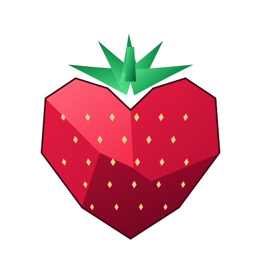
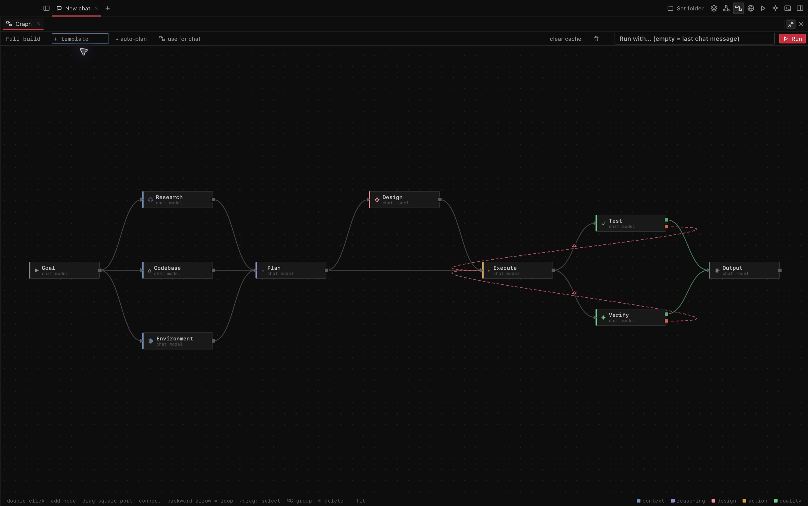
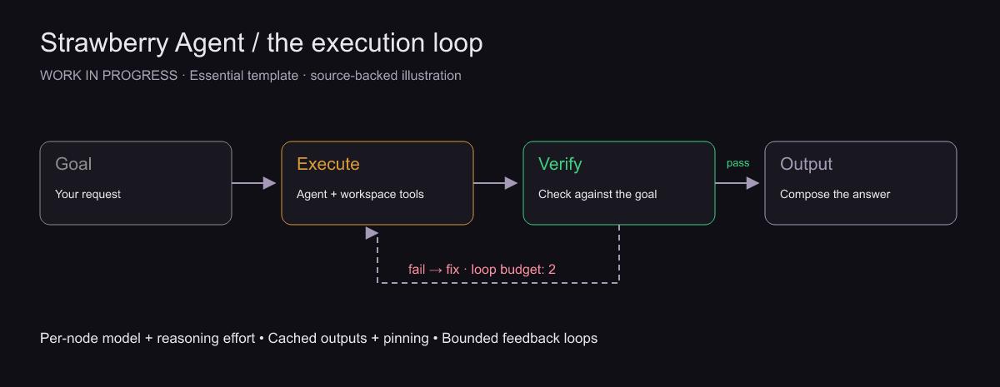
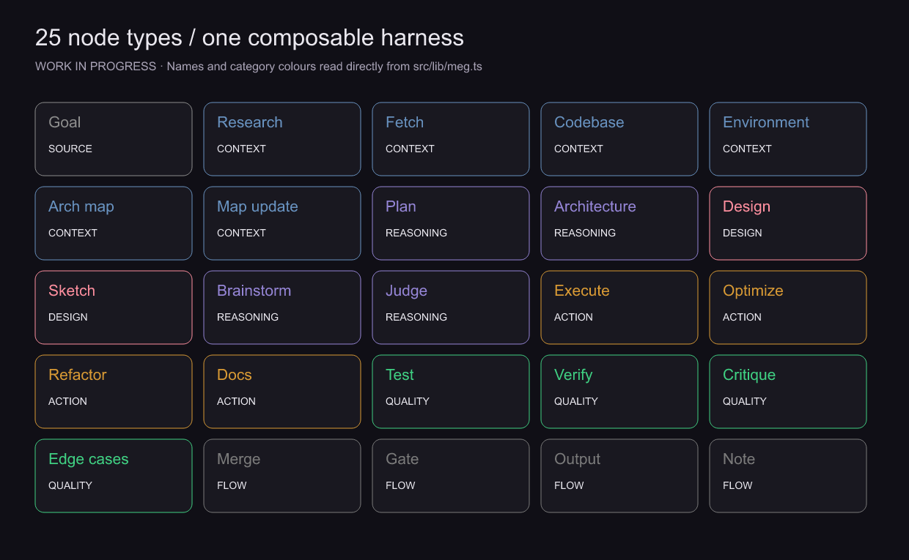
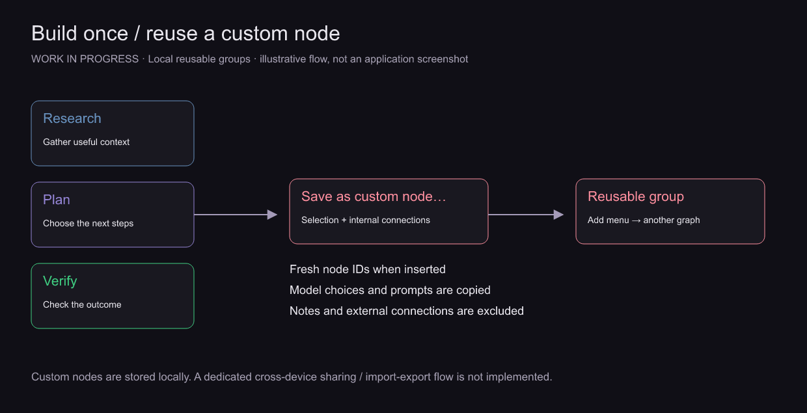
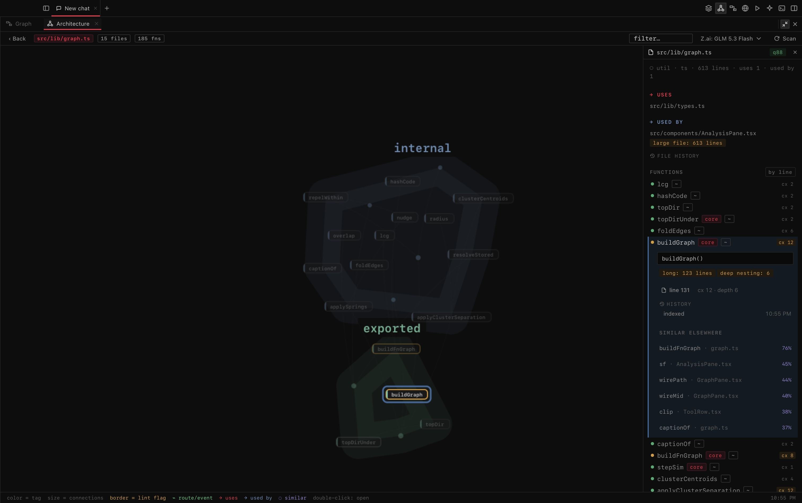

<div align="center">
  
  <h1>Strawberry Agent</h1>
  <p>A desktop coding agent with a visual, node-based execution harness.</p>
  <p><strong>WORK IN PROGRESS — experimental v0.1.0</strong></p>
</div>

Strawberry Agent connects OpenRouter models to a local coding workspace. Its **Model Execution Graph** lets you wire research, planning, design, execution, and verification into a reusable workflow, with model and reasoning settings for each stage.

> **Work in progress.** The app runs, but it is still a prototype. Expect rough edges and changes to the graph editor, execution engine, and saved formats.



*The Full build template in the desktop app: context branches feed a plan, then implementation passes through test and verification loops.*

## The harness engine

Each chat can use a graph instead of a single agent loop. Nodes receive upstream outputs, perform their stage, and pass results downstream. Some nodes call a model once; agent-backed nodes can use workspace tools; flow and human-input nodes handle coordination.

- **Per-node models and reasoning:** inherit the chat model or choose a model and effort for an individual stage.
- **Verification loops:** Test and Verify have `pass` and `fail` ports. Loop edges have a retry budget, so a failed check can return evidence to the implementation stage.
- **Parallel branches:** independent ready stages can run concurrently before merging their outputs.
- **Caching and pinning:** matching inputs can reuse cached artifacts; pin a node to retain its saved output. Review pinned context when the task changes.
- **Human gates:** pause to approve or reject work. A Sketch node opens a drawing surface for wireframes and annotated references.
- **Custom nodes:** save a selection as a reusable group, then insert it into other graphs.
- **Automatic graph planning:** a model can propose a graph using built-in kinds and saved custom stages.
- **Run visibility:** stage status, artifacts, elapsed time, and recorded token usage/cost are available in the graph and transcript.



The built-in **Essential** template is `Goal → Execute → Verify → Output`, with a failure edge from Verify back to Execute and a loop budget of two. Other templates are **Full build**, **Design first**, **Research report**, **Bug hunt**, and **Code health**.

## Node catalogue



| Category | Nodes | Purpose |
| --- | --- | --- |
| Source | Goal | Turn the request into a brief, or pass it through with an empty prompt |
| Context | Research, Fetch, Codebase, Environment, Arch map, Map update | Gather sources, assets, repository context, and architecture information |
| Reasoning | Plan, Architecture, Brainstorm, Judge | Plan the work, generate alternatives, and choose an approach |
| Design | Design, Sketch | Establish visual direction or accept a human drawing |
| Action | Execute, Optimize, Refactor, Docs | Run the tool-using implementation stages |
| Quality | Test, Verify, Critique, Edge cases | Exercise the result, gate progress, or supply review feedback |
| Flow | Merge, Gate, Output, Note | Combine branches, request approval, compose an answer, or attach instructions |

See the [node catalogue and templates](src/lib/meg.ts) for default instructions and the [Rust executor](src-tauri/src/meg.rs) for scheduling and execution behavior.

## Reusing nodes



1. Open **Model Execution Graph** with `⌘⇧E`.
2. Choose a template, or build a graph from the node add menu.
3. Select the stages you want to reuse. Use **Save as custom node…** in the context menu and give the selection a name.
4. Find the saved item under **custom nodes** in the add menu and insert it into another graph.
5. Expand the group to change individual prompts, model choices, and connections.

Saved custom nodes copy the selected stages and their internal connections; insertion creates fresh IDs. Note nodes and connections to stages outside the selection are excluded. Groups are a visual organization layer; their underlying stages still execute individually.

**Sharing status:** local saving and reuse are implemented. A dedicated cross-device or public node-sharing service, and a user-facing graph import/export flow, are not implemented in this snapshot.

## Explore files and functions

The **Architecture map** (`⌘⇧G`) is a second graph view. It maps the code you are working on, while the execution graph controls how the agent approaches a task.



*The app inspecting its own `src/lib/graph.ts`. Selecting `buildGraph` shows its location, branching and nesting counts, history, and similar functions.*

Choose a working folder, open the architecture map, and scan it. Click a file to inspect its dependencies and functions; double-click a file node to open its function graph. Selecting a function highlights similar code and shows its details in the side panel. Folder filters help narrow a large repository.

The initial scan finds files, functions, relationships, and quality hints locally. Model-assisted scans add descriptions. Complexity, similarity, and unused-code flags are heuristics: inspect the code before treating them as a reason to refactor or delete it.

These screenshots use the local static scan, without model-generated annotations. Developers can generate that scan with:

```sh
cd src-tauri
cargo run --bin arch_scan -- /path/to/workspace
```

## Around the graph

- **Chat:** streamed responses, reasoning traces, attachments, model selection, fallback models, conversation memory tools, and a floating side chat.
- **Workspace:** file browsing, editing, diffs, change snapshots/revert, terminal panes, and an iframe-based browser surface.
- **Architecture map:** repository scanning, file/function relationships, model-assisted descriptions, and persisted workspace context.
- **Tools:** filesystem operations, search, shell commands, SSH, web research/downloads, image capture/sharing, and Git operations. Availability depends on permissions and node configuration.
- **Permissions:** Read only, Ask first, Accept edits, and Auto modes, with path restrictions and optional command sandboxing. Review the selected mode before running a workflow that can change files or execute commands.
- **Local services:** SQLite storage, OS-keychain credentials, local PTYs, and SSH sessions.
- **Rendering:** Markdown, syntax highlighting, tables, Mermaid, and LaTeX.

## Run locally

You need Node.js/npm, Rust/Cargo, and the native build dependencies required by Tauri 2 for your operating system. The Rust manifest declares a minimum Rust version of **1.85**; locked dependencies may require a newer compiler. Use a current Node release compatible with the checked-in Vite version.

```sh
git clone https://github.com/gitbharrat/strawberry-agent.git
cd strawberry-agent
npm ci
npm run app
```

Add your OpenRouter API key in the application. The app uses the OS keychain for credentials. Model availability and API charges depend on your OpenRouter account.

`npm run app` starts the native Tauri application. `npm run dev` starts only the frontend development server; backend commands require the native application.

### Build and checks

```sh
npm run build       # Frontend production build
npm run check       # TypeScript, Biome, then Rust clippy
npm run app:build   # Native build and configured bundles
```

Native bundles depend on the host OS, installed platform toolchains, and signing configuration. A successful frontend build does not establish that a native installer works.

To regenerate these documentation images after installing dependencies, use Node 23+ with TypeScript stripping:

```sh
node --experimental-strip-types tools/render-docs.mjs
```

## Useful shortcuts

| Shortcut | Action |
| --- | --- |
| `⌘K` | Command palette |
| `⌘N` | New chat |
| `⌘⇧E` | Model Execution Graph |
| `⌘⇧G` | Architecture map |
| `⌘⇧A` | Floating side chat |
| `⌘⇧F` | File browser |
| `⌘⇧D` | Latest diff |
| `⌘,` | Settings |
| `Esc` | Close an overlay or stop a run |

On the graph canvas, `F` fits the graph, `⌘/Ctrl+D` duplicates the selection, and `⌘/Ctrl+G` groups selected nodes.

## Code layout

| Location | Responsibility |
| --- | --- |
| `src/components/GraphPane.tsx` | Node canvas, inspector, wiring, and reusable groups |
| `src/lib/meg.ts` | Graph types, 25 node definitions, and six templates |
| `src/components/SketchPad.tsx` | Human sketch input |
| `src-tauri/src/meg.rs` | Graph scheduling, stage execution, loops, and caching |
| `src-tauri/src/agent/` | Agent loop, prompts, and run events |
| `src-tauri/src/tools/` | Tool definitions and implementations |
| `src-tauri/src/analysis/` | Workspace architecture analysis |
| `src-tauri/src/openrouter.rs` | Model API and streaming client |
| `src-tauri/src/db.rs` | SQLite persistence |
| `src-tauri/src/journal.rs` | File change snapshots and revert |
| `src-tauri/src/terminal.rs` | Local and remote terminal sessions |
| `docs/images/` | README diagrams in PNG and SVG |

## Still to do

Portable graph sharing/import-export, broader end-to-end tests, native installer checks, and improvements to the browser/design experience are still needed. MCP support is planned.

This repository is a standalone snapshot of Strawberry Agent, including local development changes present when it was prepared. Runtime data, workspace architecture caches, installed dependencies, and build outputs are excluded.

### About the images

`app-full-build.png` and `app-functions.png` are captures of the running macOS development app. The other images are explanatory diagrams; their editable SVGs are included beside the PNGs. Screenshots show the existing local debug backend with this snapshot’s frontend, not a newly built release installer.
